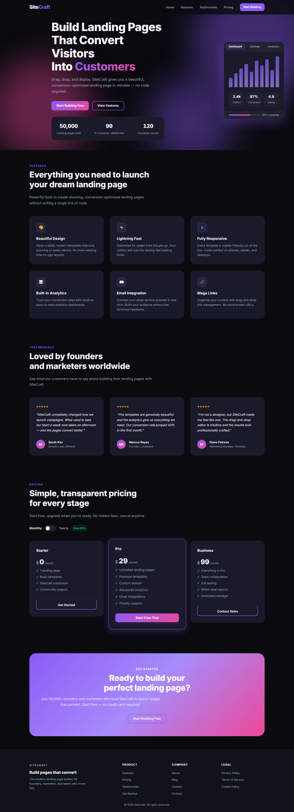

# SiteCraft — Landing Page

A beautiful, modern, fully responsive landing page for **SiteCraft**, a drag-and-drop
landing page builder. Built with plain HTML, CSS, and JavaScript — zero dependencies,
zero build step.



## Overview

SiteCraft features a dark, glassmorphism-inspired design with vibrant purple-to-pink
gradient accents, animated hero background shapes, and smooth scroll-triggered
animations. Just open `index.html` in a browser — that's it.

## Features

- **Sticky glass navigation** — blurred translucent nav bar that gains a solid
  background on scroll, with a working mobile hamburger menu
- **Animated hero** — headline with gradient highlight, floating background shapes,
  animated counters (50,000+ pages built, 99% satisfaction, 120 countries), and an
  interactive dashboard preview card with tabs and a conversion chart
- **Features grid** — six feature cards with scroll-reveal animations
- **Testimonials** — three customer cards with star ratings and avatars
- **Pricing with monthly / yearly toggle** — three plans with a switch to flip
  billing periods; prices update with a smooth transition (see below)
- **Gradient CTA section** and a full **footer** with sitemap columns
- **Scroll-to-top button** and smooth in-page anchor scrolling

## Pricing toggle

The pricing section ships with a **Monthly / Yearly** billing switch:

| Plan     | Monthly | Yearly (per month) |
|----------|---------|--------------------|
| Starter  | $0      | $0                 |
| Pro      | $29     | $23                |
| Business | $99     | $79                |

Yearly billing saves **20%** (≈ two months free). Each price element carries
`data-monthly` / `data-yearly` attributes in the markup, and `script.js` swaps the
values with a short fade/slide transition when the toggle (or either label) is
clicked. Adding a new plan only requires adding the two data attributes — no JS
changes.

## Tech stack

| Layer    | Tech                                                   |
|----------|--------------------------------------------------------|
| Markup   | Semantic HTML5                                          |
| Styling  | Hand-written CSS3 (custom properties, flexbox, grid)    |
| Behavior | Vanilla ES6+ JavaScript (IntersectionObserver, etc.)    |
| Type     | [Inter](https://fonts.google.com/specimen/Inter) via Google Fonts |

No frameworks, no bundlers, no npm.

## Project structure

```
site-craft/
├── index.html            # Page markup
├── style.css             # All styles (CSS variables, sections, responsive)
├── script.js             # All interactivity (counter, toggle, nav, reveals)
└── screenshots/
    └── full-page.png     # Full-page screenshot used above
```

## Getting started

No installation required:

```bash
# Option 1 — just open it
start index.html

# Option 2 — serve it locally
python -m http.server 8000
# then visit http://localhost:8000
```

## Interactions implemented in `script.js`

- Animated stat counters (count up when scrolled into view)
- Navbar background/shadow on scroll (`.scrolled`)
- Mobile menu toggle (hamburger)
- **Monthly / yearly pricing toggle** with animated price swap
- Scroll-to-top button (appears after 500px)
- Smooth scrolling for in-page anchor links (with nav offset)
- Scroll-reveal animations for cards and sections via `IntersectionObserver`

## Customization

The whole design is driven by CSS custom properties at the top of `style.css`:

```css
:root {
    --color-primary: #8b5cf6;   /* purple accent   */
    --color-accent:  #ec4899;   /* pink accent     */
    --color-bg:      #0a0a0f;   /* page background */
    /* …radii, spacing, transitions… */
}
```

Change those variables to re-theme the entire page in seconds.

## Browser support

Modern evergreen browsers (Chrome, Edge, Firefox, Safari). Uses
`IntersectionObserver`, CSS custom properties, `backdrop-filter`, and flexbox/grid.
